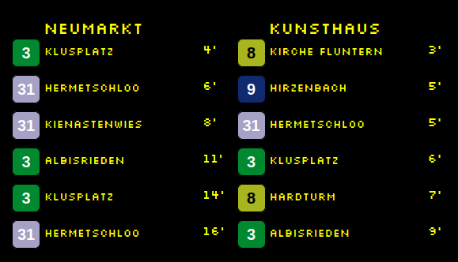

# mmm-abfahrten

Magic Mirror Module to show the departure table of multiple stations. This works with the https://search.ch/timetable/api/help API.



## Configuration

```yaml
updateInterval: 5 * 60 * 1000, // Update every 5 minutes.
fetchCount: 12, // Number of connections to fetch per stop.
apiBase: 'https://search.ch/timetable/api/stationboard.json', // API from search.ch
stops: ['Kunsthaus', 'Neumarkt'], // stops you want information
minuteOffset: 3,
replaceDestinationString: [
    ['Zürich, ', ''],
    ['Zürich ', ''],
    [', Bahnhof', '']
]
```

## Develop

```
docker run -p 8080:8080 -v ./config:/opt/magic_mirror/config -v ./:/opt/magic_mirror/modules/mmm-abfahrten -e TZ="Europe/Berlin" karsten13/magicmirror
```

